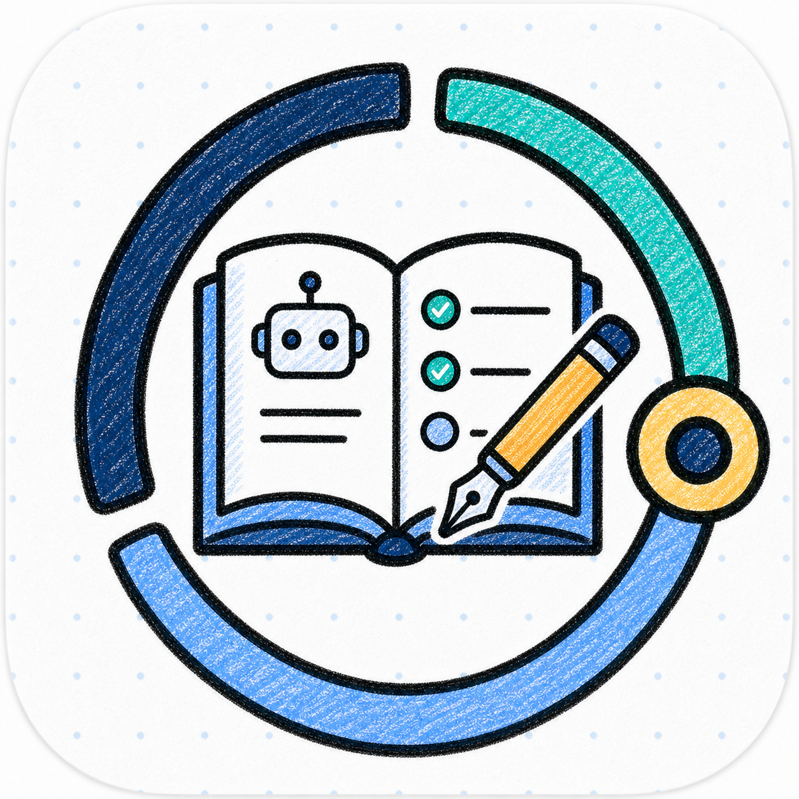
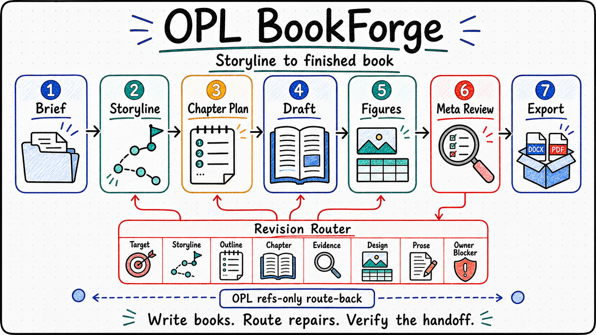

  

<strong>English</strong> | <a href="./README.zh-CN.md">中文</a>

<h1 align="center">OPL Book Forge</h1>

OPL Book Forge helps authors turn talks, interviews, and notes into a book readers can follow and authors can review chapter by chapter.

  

## Shape the book before writing it

Share your material, intended readers, and the book you want to make. Book Forge first shapes the storyline and identifies the question each chapter should answer. Once you approve the direction, it carries that same book through chapter drafts, figures, source checks, and style review. It can build on your existing library, writing preferences, and earlier decisions.

When you return to revise the manuscript, start from what is already there and decide whether the work belongs in the storyline, chapter structure, evidence, or prose. You decide which revisions to adopt and when a version can be handed off. Chapter drafts, review PDFs, and publication proofs each give you a concrete result to inspect along the way.

## Start with material or a manuscript

> “Use these talks and interviews to propose a storyline and show what question each chapter should answer.”

> “Use the approved storyline to develop the first three chapters. Flag gaps in the evidence and give me a review copy I can annotate.”

## Get started

Install **OPL Book Forge** from the OPL Software Center. Open a registered book project and share the intended readers, source material, and result you want this time. Reviewing a storyline is one way to start. Validation of the full publication workflow is ongoing. [Workflow stages](docs/architecture.md) · [Current status](docs/status.md)

## Verification

Maintainers can run `scripts/verify.sh` for local checks and `scripts/verify.sh full` to include Framework verification. [Documentation](docs/README.md) · [Evidence](docs/evidence/README.md)
