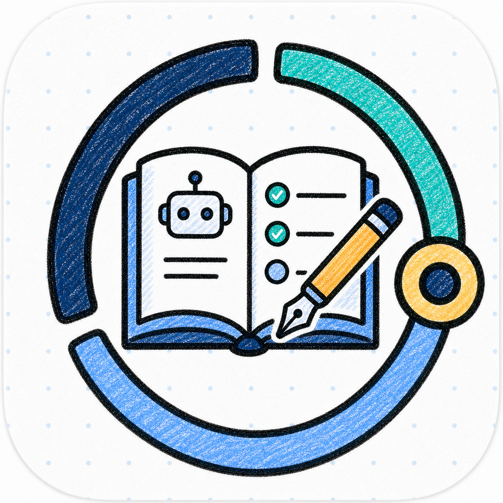
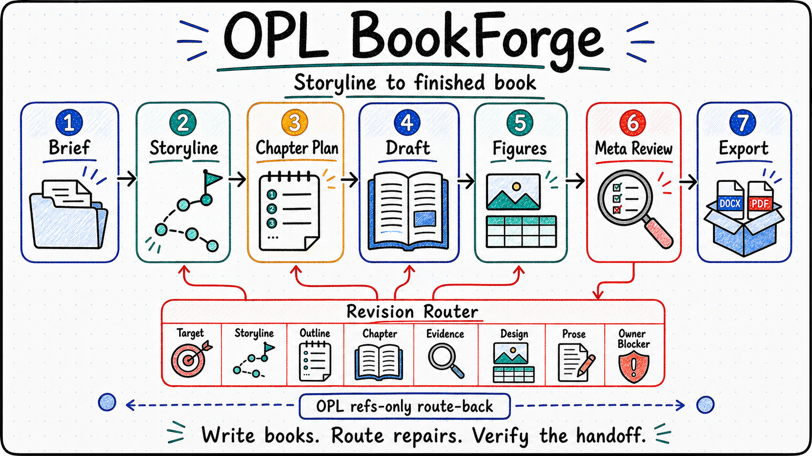

  

<a href="./README.md">English</a> | <strong>中文</strong>

<h1 align="center">OPL Book Forge</h1>

OPL Book Forge 帮作者把散落的讲稿、访谈和笔记整理成一本读者读得懂、作者可以逐章审阅的书。

  

## 先把一本书想清楚

给出材料、目标读者和想写成的样子，Book Forge 先整理全书的故事线和各章要回答的问题。作者确认主线后，智能体沿同一本书推进写作、图表、来源核对和风格审阅。它可以沿用你原来的资料库、写作偏好和已经定下的取舍。

回来修改时，可以从现有书稿开始判断问题在全书主线、章节安排、证据还是文字。作者决定改到哪里、哪一版可以交接。章节稿、审阅 PDF 和出版校样都对应各自要核对的内容，你可以逐步看清一本书走到了哪里。

## 从材料或书稿开始

> “用这批讲稿和访谈，先给我一条全书主线，说明每一章要回答什么问题。”

> “沿用确认过的故事线推进前三章，标出证据缺口，给我一份可以批注的审阅稿。”

## 开始使用

在 OPL 软件中心安装 **OPL Book Forge**，打开已经登记的书籍项目，给出读者、材料和这轮希望收到的成果。第一项工作可以是审阅故事线。完整的出版交付流程仍在验证中。[工作阶段](docs/architecture.md) · [当前状态](docs/status.md)

## 验证

维护者可用 `scripts/verify.sh` 执行本地检查，使用 `scripts/verify.sh full` 加入 Framework 结构回读。[文档导览](docs/README.md) · [证据包](docs/evidence/README.md)
